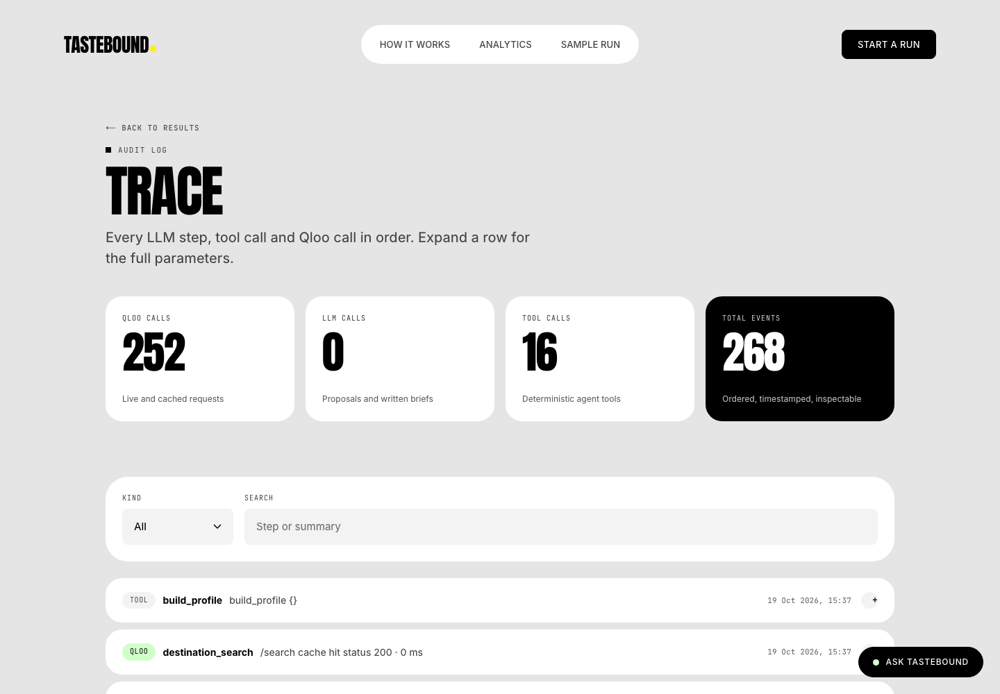
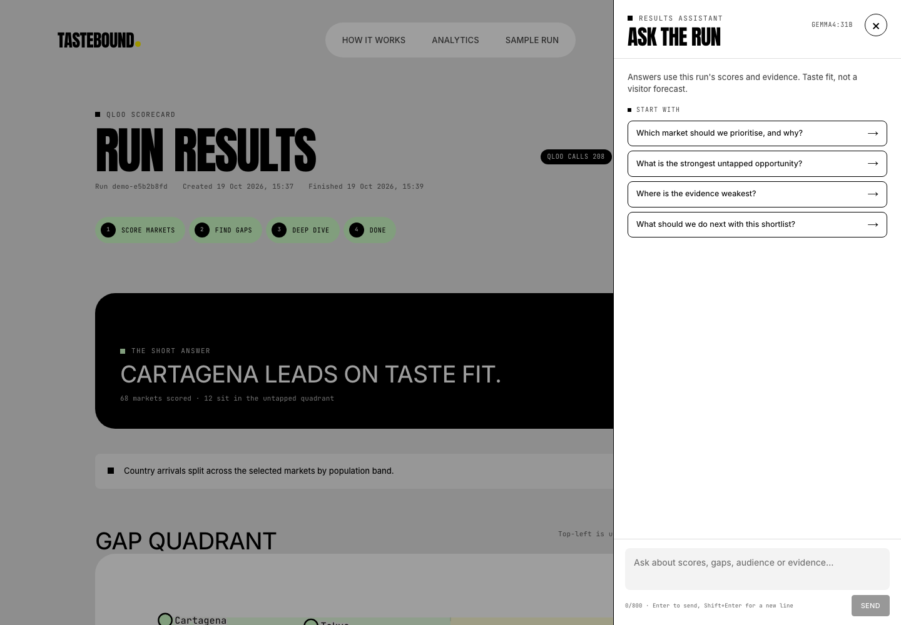
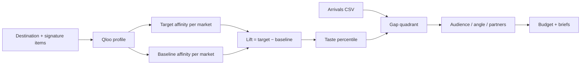

<p align="center">
  
</p>

<p align="center">
  <sub><strong>Qloo Agentic Hackathon 2026</strong> · Next.js · FastAPI · SQLite/Postgres · Ollama Cloud · MIT</sub>
</p>

**TasteBound** finds the origin markets that already share a destination's taste but are not visiting yet. It builds a Qloo taste profile, scores every origin market by **taste lift over a popularity baseline**, compares that with **your visitor arrivals**, and turns the gap into audiences, campaign angles, media partners, a budget split and grounded briefs.

**Taste fit, not a visitor forecast.** Qloo decides. Scores, gaps, audience signals, angle evidence and partners are computed in code from Qloo responses. The LLM may suggest destination items; any model-written prose must pass a grounding validator, and fallbacks are labelled.

<p align="center">
  <a href="#quickstart"><strong>Quickstart</strong></a> ·
  <a href="#the-gap-quadrant"><strong>See the results</strong></a> ·
  <a href="#how-it-works"><strong>How it works</strong></a> ·
  <a href="docs/03-architecture.md">Architecture</a> ·
  <a href="docs/DESIGN.md">Design system</a>
</p>

| In                                                 | Out                                                                                                                                         | Try it                                                               |
| -------------------------------------------------- | ------------------------------------------------------------------------------------------------------------------------------------------- | -------------------------------------------------------------------- |
| A destination, signature items and an arrivals CSV | Ranked origin markets, an untapped-market quadrant, audience signals, campaign angles, media partners, a budget split and exportable briefs | `/sample` runs the stored Lisbon demo with no keys and no Qloo spend |

## The gap quadrant

Taste score on one axis, arrivals share on the other. **Untapped** markets sit top-left: strong taste fit, few visitors today. Click any point to open the full market brief.

**Sample run:** 68 markets scored, 12 in the untapped quadrant. Cartagena ranks #1 with a taste score of **99.26** and a **+98.2-point** arrivals gap.

<p align="center">
  
</p>

## What a market gives you

Taste score, lift, coverage and a plain-language confidence explainer; arrivals share, percentile and gap; a Qloo demographic signal; a campaign angle where each claim carries an evidence chip; partner tabs; global brands.

<p align="center">
  
</p>

## Plan the spend

Split a budget across markets with locks; each market's share is weighted by taste score, confidence and the untapped gap. Briefs are editable, labelled `template` or `model-written`, and export as Markdown. The full run exports as CSV.

<p align="center">
  
</p>

## Audit every call

Every run writes an ordered, timestamped trace of Qloo calls and internal tool steps, with parameters and cache status; every number links back to the Qloo calls that produced it. Live runs also record LLM rows when a model call is made.

<p align="center">
  
</p>

## Ask the run

A read-only assistant answers questions about a completed run: why a market ranks where it does, what the arrivals gap means, who the audience is, which evidence supports an angle and where the caveats are. It is available from the results header, each market brief and the floating launcher.

The model never sees the database or chooses a tool. For every question the API rebuilds a bounded context from the stored run, asks for JSON, then validates the answer against that context: every cited number must exist, every evidence ID must resolve, and every answer must cite at least one item. Invalid output gets one repair attempt; otherwise the assistant returns a clear "could not verify" error. It cannot change a run, call Qloo or forecast visitors.

<p align="center">
  <sub><strong>Read-only. Grounded. No tools.</strong> Requires <code>OLLAMA_API_KEY</code>; without it the drawer says the assistant is unavailable and the rest of the app still works.</sub>
</p>

Conversations are kept in memory for 60 minutes and are scoped to the workspace and run. They are not written to the database or the run trace; an API restart clears them. The default limits are 30 messages/hour per IP, 60/hour per workspace and 800 characters per message.

<p align="center">
  
</p>

## How it works

1. **Profile** — name a destination and add its signature items, or let TasteBound suggest them from the official website. Each item resolves to a real Qloo entity; unresolved items are listed, not hidden.
2. **Score** — for each origin market, fetch Qloo affinity for the destination's entity and its top explainability entities, then query the same markets again **without** the destination signals to get a per-market baseline. **Lift = target affinity − baseline affinity.** The taste score is the percentile of lift across the run — a ranking, not an absolute.
3. **Gap** — match your arrivals CSV (or the bundled sample) to markets. The gap quadrant and table compare taste percentile against arrivals percentile. Population correlation is checked and flagged when the ranking may track market size.
4. **Deep dive** — build audience signals, angle evidence and media partners for the shortlist, then split a budget weighted by taste score, confidence and the untapped gap.
5. **Explain** — every score, angle and partner links back to its Qloo evidence, and briefs expose their source and citations.



> **Qloo decides; the LLM narrates.** Scores, gaps, audience signals, angle evidence and partners come from Qloo through deterministic code. The LLM proposes item names; model-written prose is gated and validated.
>
> **Verify before building.** Every Qloo parameter and response field used by the app is recorded from live calls in Phase 0 (`docs/qloo-contract.md`), not guessed.
>
> **Fail closed.** Without Qloo a live run fails with `qloo_unconfigured` and zero partial ranking — a tested feature, not an error path.

## Quickstart

Requires Node 24+, pnpm, Python 3.12 or 3.13 and uv, plus a Qloo key for live runs.

```bash
pnpm install
(cd apps/api && uv sync)

# apps/api/.env
#   QLOO_API_KEY=...            # required for real runs
#   OLLAMA_API_KEY=...          # optional; enables item suggestions, gated briefs and the results assistant

pnpm turbo dev                   # web :3000, api :8000 (SQLite schema created and demo seeded)
```

Open **http://localhost:3000/sample** — a stored, read-only Lisbon run that needs no keys and spends no Qloo quota. Or start a live run at `/start`.

Key-by-key setup, run and deploy instructions: [`docs/19-setup.md`](docs/19-setup.md).

```bash
pnpm test                                     # API + web tests, no network
pnpm turbo lint check-types build
```

## Project layout

```
apps/api            FastAPI: Qloo client (rate limit, cache, budgets), scoring, arrivals, executor, results assistant, HTTP API
apps/web            Next.js: landing, 4-step wizard, results, market detail, plan, trace, sample, assistant drawer
packages/contracts  TypeScript types generated from the API's OpenAPI schema
assets/readme       README hero and screenshots
docs/               product, Qloo integration, API, frontend, security, tests and runbook
scripts/            screenshot, smoke and accessibility checks (Playwright + axe)
```

## Honest by default

- "Taste fit", never "demand" or "will visit".
- Arrivals source notes are shown wherever arrivals appear; bundled samples are labelled illustrative.
- Briefs carry their source: `template` when the model is unavailable, `model-written` when the gated model path is used and passes grounding.
- Thin-data markets are flagged, not dropped; coverage and confidence are always visible.
- Audience rows are a destination-level Qloo demographic aggregate repeated beside each shortlisted market. They are affinity signals, not per-market census data or demand.
- Orchestration is deterministic: the LLM does not choose tools. `LLM_TOOL_CALLING` stays `false`, and `/health` reports `tools_ok` from that switch.
- The trace page lists Qloo calls, internal tool steps and LLM calls in order, without keys or prompt text.

## Documentation

| Start here                                                                             | Then                                                                |
| -------------------------------------------------------------------------------------- | ------------------------------------------------------------------- |
| [Product brief](docs/00-product-brief.md)                                              | Problem, users, value and metrics                                   |
| [Architecture](docs/03-architecture.md)                                                | Runtime components, run phases and configuration                    |
| [Qloo integration](docs/04-qloo-integration.md)                                        | Multi-call chain, baseline, guards, budget and kill switch          |
| [LLM and grounding](docs/05-agent-and-llm.md)                                          | Provider layer, what the LLM may write, validation and limits       |
| [Results assistant](docs/features/F13-results-assistant.md)                            | Grounded Q&A, evidence, limits and the in-memory conversation store |
| [Data model](docs/06-data-model-supabase.md) · [data sources](docs/09-data-sources.md) | Tables and provenance · arrivals and market data                    |
| [API](docs/07-api-spec.md) · [frontend](docs/08-frontend-spec.md)                      | Endpoints and errors · screens and states                           |
| [Security](docs/10-security-and-privacy.md)                                            | Tokens, secrets, SSRF, retention and abuse limits                   |
| [Acceptance](docs/12-acceptance-criteria.md) · [tests](docs/13-test-plan.md)           | Numbered criteria · how the code is checked                         |
| [Runbook](docs/16-runbook.md) · [setup](docs/19-setup.md)                              | Operate and troubleshoot · keys and local setup                     |
| [Decisions](docs/18-risks-and-decisions.md) · [design system](docs/DESIGN.md)          | Trade-offs and risks · the visual language                          |
| [Qloo contract](docs/qloo-contract.md) · [LLM contract](docs/llm-contract.md)          | Verified request/response notes · verified provider behaviour       |

## Limits

- Taste scores rank markets **within a run**; they are percentiles of Qloo affinity lift, not calibrated demand estimates.
- Audience demographics come from Qloo and need a taste signal; they are affinity deltas, not census data.
- The bundled arrivals sample is illustrative (Statista/INE-informed), labelled as such everywhere it appears.
- Qloo coverage varies by market; thin markets are flagged with lower confidence.
- The free Ollama key hit its quota during the build, so the stored demo's briefs are templates. The sample remains fully usable without keys, and the assistant reports when no model is configured.
- Assistant conversations are process memory, not durable data. A restart or TTL expiry clears them; a multi-instance API needs a shared conversation store and rate limiter.

## License

MIT — see [`LICENSE`](LICENSE).
