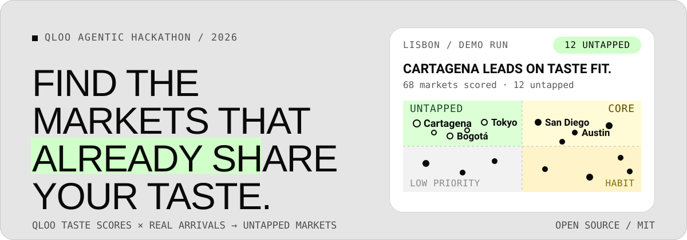
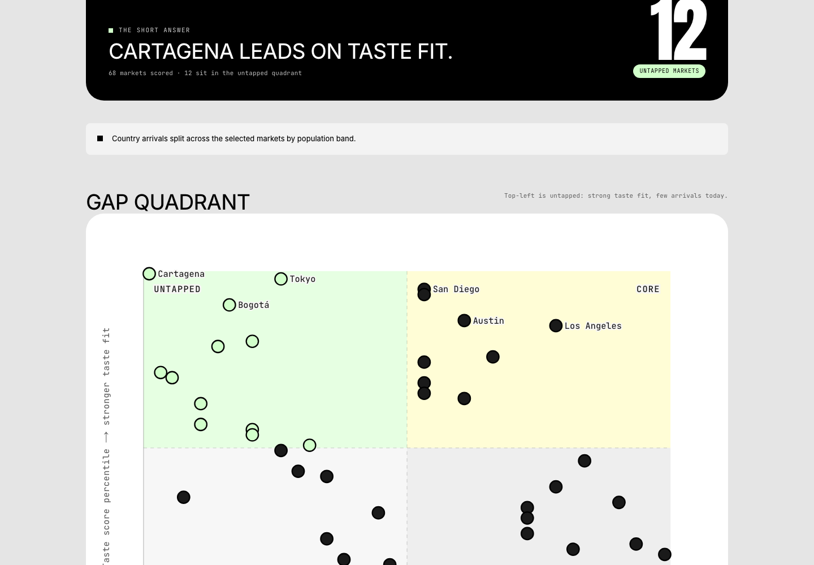
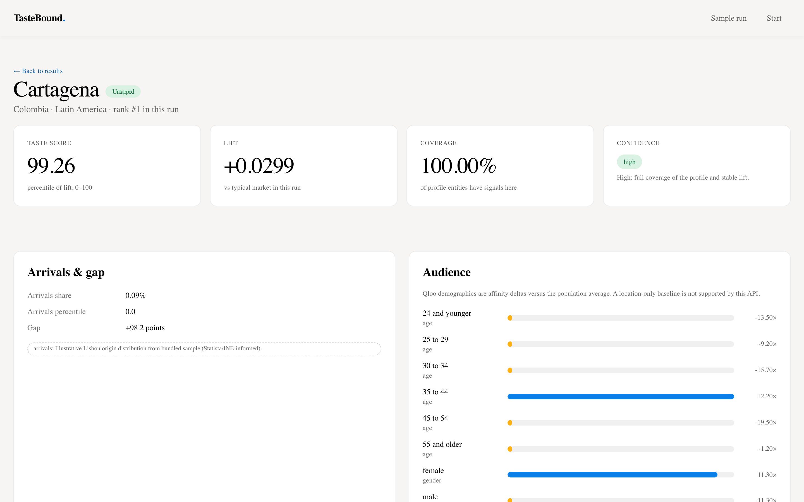
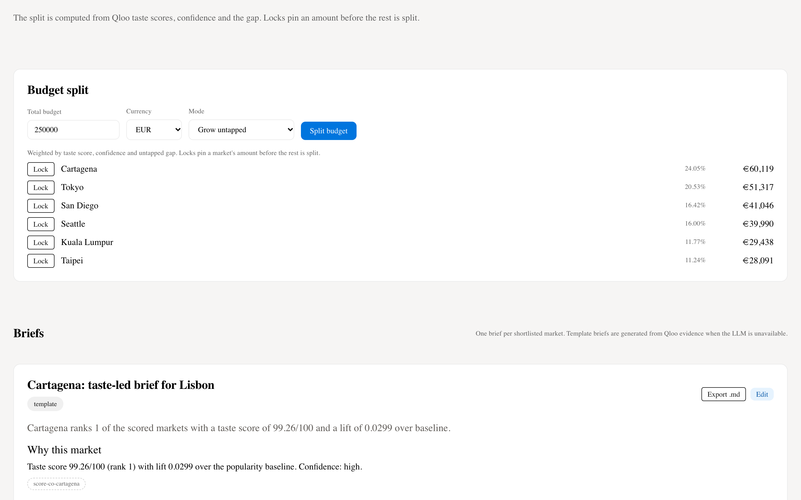

<p align="center">
  
</p>

**TasteBound** builds a Qloo taste profile for a destination, scores origin markets by **taste lift over a popularity baseline**, compares that with your **real visitor arrivals** — and shows you the **untapped markets** that already love what the destination offers but are not visiting yet. For each market it produces audiences, a campaign angle with evidence, media partners and a budget split.

Every score, gap, audience and partner comes from Qloo through deterministic code; the LLM proposes item names and writes briefs that must pass a grounding validator, and every fallback is labelled. Every number links back to the Qloo call that produced it.

Built for the **Qloo Agentic Hackathon 2026**. **Taste fit, not a visitor forecast** — no demand claims, no black boxes.

<p align="center">
  <a href="#quickstart">Quickstart</a> ·
  <a href="docs/17-judging.md">Judging notes</a> ·
  <a href="docs/16-runbook.md">Runbook</a> ·
  <a href="docs/DESIGN.md">Design</a>
</p>

## The gap quadrant

Taste score on one axis, arrivals share on the other. **Untapped** markets sit top-left: strong taste fit, few visitors today. Click any point to open the full market brief.

<p align="center">
  
</p>

## What a market gives you

Taste score, lift, coverage and a plain-language confidence explainer; arrivals share, percentile and gap; an audience chart from Qloo demographics; a campaign angle where each claim carries an evidence chip; partner tabs; global brands.

<p align="center">
  
</p>

## Plan the spend

Split a budget across markets with locks; briefs are editable, labelled `template` or `model-written`, and export as Markdown. The whole run exports as CSV.

<p align="center">
  
</p>

## How it works

1. **Profile** — you name a destination and add signature items (or let TasteBound suggest them from the website). Each item resolves to a real Qloo entity; unresolved items are listed, not hidden.
2. **Score** — for each origin market, TasteBound fetches Qloo affinity for the destination's entity and its top explainability entities, then queries the same markets again **without** the destination signals to get a per-market baseline, and computes **lift = target affinity − baseline affinity**. The taste score is the percentile of lift across the run — a ranking, not a fake absolute.
3. **Gap** — your arrivals CSV (or a bundled sample) is matched to markets; the gap quadrant and table compare taste percentile against arrivals percentile. Population correlation is checked and flagged when the ranking may track market size.
4. **Deep dive** — audiences, angle evidence and media partners for the shortlist, then briefs and a budget split weighted by taste score, confidence and the untapped gap.

Three rules above everything:

1. **Qloo decides; the LLM narrates.** The LLM proposes item names and writes prose that passes a grounding validator; scores, gaps, audiences, angle evidence and partners are pure functions over Qloo responses.
2. **Verify before building.** Every Qloo parameter and response field was recorded from live calls in Phase 0 (`docs/qloo-contract.md`), not guessed.
3. **Fail closed.** Without Qloo the run fails with `qloo_unconfigured` and zero partial ranking — a tested feature, not an error path.

## Quickstart

```bash
pnpm install
(cd apps/api && uv sync)

# apps/api/.env
#   QLOO_API_KEY=...            # required for real runs
#   OLLAMA_API_KEY=...          # optional; without it briefs are labelled templates

pnpm turbo dev                   # web :3000, api :8000 (SQLite, auto-migrated and seeded)
```

Open **http://localhost:3000/sample** — a stored, read-only Lisbon run that needs no keys and spends no Qloo quota. Or start a live run at `/start`.

Key-by-key setup, run and deploy instructions: [`docs/19-setup.md`](docs/19-setup.md).

```bash
(cd apps/api && uv run pytest -m "not live")   # 48 tests, no network
pnpm turbo lint test build
```

## Project layout

```
apps/api     FastAPI: Qloo client (rate limit, cache, budgets), scoring, arrivals, agent, HTTP API
apps/web     Next.js: landing, 4-step wizard, results, market detail, plan, trace, sample
packages/contracts   TypeScript types generated from the API's OpenAPI schema
docs/        the full documentation pack (product, Qloo integration, API, tests, runbook)
scripts/     smoke and accessibility checks (Playwright + axe)
```

## Honest by default

- "Taste fit", never "demand" or "will visit".
- Arrivals source notes are shown wherever arrivals appear; bundled samples are labelled.
- Briefs carry their source: `template` when the LLM is unavailable, `model-written` when it is.
- Thin-data markets are flagged, not dropped; coverage and confidence are always visible.
- The trace page lists every LLM step, tool call and Qloo call in order, parameters included.

## Documentation

| Start here | Then |
|---|---|
| [`docs/00-product-brief.md`](docs/00-product-brief.md) | Problem, users, value, metrics |
| [`docs/04-qloo-integration.md`](docs/04-qloo-integration.md) | How Qloo is used: multi-call chain, strategies, baseline, budget, kill switch |
| [`docs/05-agent-and-llm.md`](docs/05-agent-and-llm.md) | Agent tools, Ollama Cloud, provider portability |
| [`docs/07-api-spec.md`](docs/07-api-spec.md) · [`docs/08-frontend-spec.md`](docs/08-frontend-spec.md) | API endpoints · screens and states |
| [`docs/12-acceptance-criteria.md`](docs/12-acceptance-criteria.md) · [`docs/13-test-plan.md`](docs/13-test-plan.md) | Numbered criteria · how they are tested |
| [`docs/16-runbook.md`](docs/16-runbook.md) · [`docs/17-judging.md`](docs/17-judging.md) | Setup, run, deploy · judging rules and demo script |
| [`docs/progress.md`](docs/progress.md) · [`docs/18-risks-and-decisions.md`](docs/18-risks-and-decisions.md) | Live status · decisions and risks |

## Limits

- Taste scores rank markets **within a run**; they are percentiles of Qloo affinity lift, not calibrated demand estimates.
- Audience demographics come from Qloo and need a taste signal; they are affinity deltas, not census data.
- The bundled arrivals sample is illustrative (Statista/INE-informed), labelled as such everywhere it appears.
- Orchestration is deterministic by design: tool choice stays in code, and the LLM proposes item names and writes grounded briefs when a key is present. The Ollama Cloud tool-calling loop is spec'd behind the provider layer but disabled (`LLM_TOOL_CALLING=false`) until tool calling is verified live; `/health` reports `tools_ok` accordingly.

## License

MIT — see [`LICENSE`](LICENSE).
