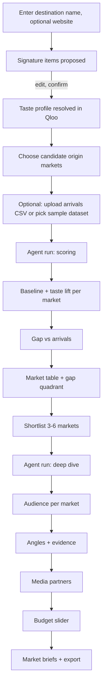

# 02. User flows

## Flow A: DMO marketer, first run (the demo flow)

1. **Intake.** The user types a destination ("Lisbon, Portugal") and optionally its tourism website. The app reads up to 3 pages and the agent proposes 5–15 **signature items**: landmarks, neighbourhoods, dishes, drinks, festivals, music, films or books tied to the place. The user edits the list.
2. **Taste profile.** Each item is resolved to Qloo entities (places, localities, artists, films, books, brands as relevant). Unresolved items are listed. Qloo tags on the resolved entities form the profile's tag cloud. The user can remove entities.
3. **Markets.** The user picks 20–40 candidate origin cities from the catalogue (preset groups: "Europe top 20", "North America top 15", "Asia-Pacific top 15") or adds cities by search.
4. **Arrivals (optional but needed for the gap view).** Upload a CSV `origin_city_or_country, arrivals, year` or choose a bundled public sample for the demo destination.
5. **Scoring run.** The agent builds the profile, runs baseline and taste queries per market, computes lift and confidence, joins arrivals and computes gaps. Progress and Qloo calls stream live.
6. **Results.** A ranked market table and a **gap quadrant** (x = arrivals share, y = taste lift). Quadrants: *Untapped* (high taste, low arrivals), *Core* (high, high), *Saturated or habit* (low taste, high arrivals), *Low priority*.
7. **Shortlist** 3–6 markets, start the **deep-dive run**: audience, angles, media partners per market.
8. **Budget.** Enter a total budget; the allocator proposes shares; the user adjusts with sliders; shares re-normalise.
9. **Briefs.** One brief per market (angle, audience, partners, evidence chips), editable, export as Markdown, print view, and CSV of the table.

## Flow B: Judge or visitor (demo mode)

Landing → "See a sample run" → the stored run for the demo destination: all pages, trace and briefs, no keys needed. A live run is allowed with daily limits.

## Flow C: No arrivals data

The scoring run completes without the gap view. The quadrant is replaced by the lift ranking with a note: "Upload arrivals to find untapped markets."

## Error flows

| Situation | Behaviour |
|---|---|
| Website unreadable | Continue with the name; the agent proposes items from the name only, clearly labelled |
| Fewer than 3 signature items resolve | Run blocked: "Qloo doesn't know enough about this destination; add better-known items" |
| Qloo key missing or invalid | Scoring fails with a clear error and retry; no scores from any other source |
| A market returns too little data | Shown with `low` confidence and a "thin data" flag |
| Arrivals CSV invalid | Row-level errors listed; valid rows kept; gap view only for matched markets |
| LLM unavailable | Scores, gaps, audiences and partners still work; briefs use the template and are labelled |
| Budget cap reached | Run stops, partial results kept, notice shown |
