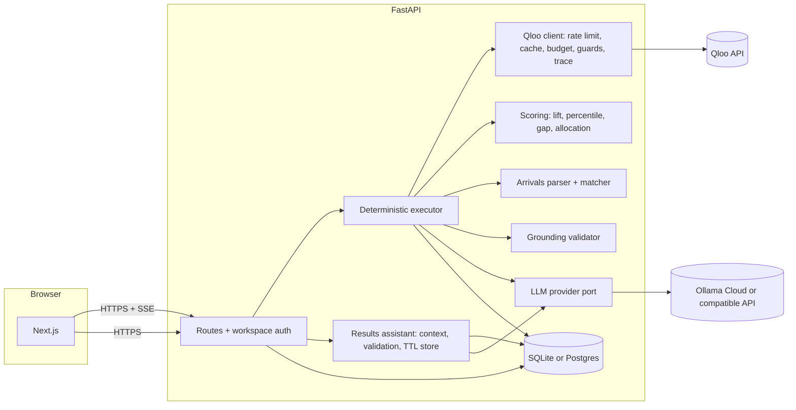
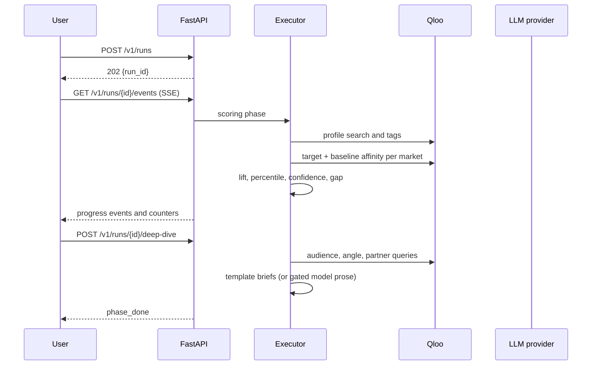

# 03. Architecture

## Monorepo layout

```
.
├─ apps
│  ├─ web                                   # Next.js App Router
│  │  ├─ app/
│  │  │  ├─ page.tsx                        # landing
│  │  │  ├─ start/page.tsx                  # intake wizard
│  │  │  ├─ runs/[id]/page.tsx              # progress, gap quadrant, market table
│  │  │  ├─ runs/[id]/markets/[marketId]/page.tsx
│  │  │  ├─ runs/[id]/plan/page.tsx         # budget, briefs, export
│  │  │  ├─ runs/[id]/trace/page.tsx        # ordered call trace
│  │  │  ├─ analytics/page.tsx
│  │  │  └─ sample/page.tsx                 # stored demo run
│  │  ├─ components/                        # charts, tables, evidence, wizard, UI
│  │  └─ lib/                               # typed API client, SSE, formatting, hooks
│  └─ api                                   # FastAPI (Python 3.12/3.13, uv)
│     ├─ src/tastebound_api/
│     │  ├─ main.py  settings.py  errors.py  schemas.py
│     │  ├─ security.py  ratelimit.py  grounding.py
│     │  ├─ db/                             # async engine, tables, demo fixture seeding
│     │  ├─ qloo/                           # client, rate limit, cache, budget, guards, trace
│     │  ├─ scoring/                        # lift, percentile, gap, allocation (pure)
│     │  ├─ arrivals/                       # CSV parsing and market matching
│     │  ├─ external/website_reader.py      # SSRF-safe page reader
│     │  ├─ agent/                          # deterministic executor + plan guard helpers
│     │  ├─ assistant/                      # run context, evidence validation, in-memory conversations
│     │  ├─ llm/                            # provider port, OpenAI-compatible adapter, prompts
│     │  ├─ data/                           # market catalogue and sample arrivals
│     │  └─ routes/                         # health, workspaces, markets, destinations,
│     │                                      arrivals, runs, demo, assistant
│     ├─ scripts/                           # phase-0 spikes, demo export, OpenAPI export
│     └─ tests/                             # unit, contract, API and opt-in live tests
├─ packages
│  ├─ contracts                             # TS types generated from apps/api/openapi.json
│  ├─ ui  eslint-config  typescript-config
├─ assets/readme                            # README hero and screenshots
├─ docs/                                    # this documentation pack
├─ scripts/                                 # Playwright screenshots, smoke and axe checks
├─ supabase/                                # local Supabase configuration scaffold
└─ turbo.json  pnpm-workspace.yaml  package.json
```

`apps/api/package.json` holds wrapper scripts that call `uv`, so Turborepo can drive both apps. The API owns all Qloo, LLM and database access.

## Components



The browser talks only to FastAPI. Qloo and LLM keys never leave the API. SSE is used for run progress; the stored demo can render without a live connection.

## Run phases

1. **Scoring phase** — `build_profile` → `score_markets` → `compute_gaps` → `finish_phase`. The executor runs this fixed sequence in code. `score_markets` fetches a target and a baseline affinity for each market; `compute_gaps` joins the run's arrivals dataset and ranks the quadrant.
2. **Deep-dive phase** — after the user selects a shortlist, `market_audience` → `market_angles` → `media_partners` → `write_briefs` → `finish_phase`.
3. **Allocation** — pure code, recalculated immediately when the user moves budget sliders or changes locks. No model call.
4. **Trace** — every Qloo call, tool step, warning and optional run-path LLM call is stored as an ordered run event. The trace page can replay a run from these rows. Post-run assistant calls are not written to the run trace.



## Deterministic orchestration

The shipped executor is a fixed pipeline, not an LLM tool-choice loop:

- The LLM may propose signature item **names** during intake. Qloo resolves or rejects each name; entity IDs come only from Qloo.
- The model-writing path for briefs is behind `LLM_TOOL_CALLING=false` and is disabled in the shipped configuration. Template briefs are the default and are labelled as such.
- `agent/plan_guard.py` contains ordering and argument checks used by tests and by the executor's validation boundary. The model does not select or order tools.
- `/health` reports `tools_ok: false` while tool calling is disabled. Live tool calling is not claimed.

## Post-run results assistant

The assistant is a separate, read-only surface after scoring:

- `routes/assistant.py` checks workspace ownership, provider readiness and per-IP/per-workspace message limits.
- `assistant/context.py` rebuilds a bounded evidence bundle from stored run rows on every message. The browser never supplies scores or evidence.
- `assistant/service.py` calls the configured provider with the system prompt, run context and bounded history. It is non-streaming and asks for JSON.
- `assistant/validation.py` verifies JSON shape, answer length, 1–6 known evidence IDs, numbers and names against the context, with exactly one repair attempt.
- `assistant/store.py` keeps conversations in process memory with a TTL and a one-message-per-conversation lock. Nothing is written to SQLite/Postgres, `llm_calls` or the run trace.

The assistant has no Qloo access, tools, SQL, URL fetches or mutation endpoints. If the model is unconfigured, bootstrap returns `enabled=false`; message creation returns `assistant_unavailable`. A multi-instance deployment would need a shared conversation store and rate limiter. See `features/F13-results-assistant.md`.

## Identity and access

`POST /v1/workspaces/session` returns an HMAC-signed workspace token (`SESSION_SECRET`). The web app stores it in `localStorage` (`tb_ws`) and sends `X-Workspace-Token` on every request. The SSE endpoint accepts the token as a query parameter because `EventSource` cannot set headers.

Every user-owned row carries `workspace_id`; every read and write filters by it. The demo workspace owns the stored Lisbon run and is read-only for other workspaces (`demo_read_only`). There are no user accounts or browser-side Supabase calls.

## Database

- **Local default:** SQLite at `apps/api/data/tastebound.db`, using `aiosqlite`, WAL and a 30 s busy timeout.
- **Deployment option:** Postgres/Supabase through `DATABASE_URL`. The engine enables `statement_cache_size=0` for asyncpg and a direct or session connection is recommended.
- Tables are created at startup with SQLAlchemy metadata (`init_db`); the market catalogue and the stored demo fixture are seeded idempotently. `supabase/migrations/` is a scaffold, not the source of truth for the current schema.
- The demo fixture is `apps/api/data/demo/lisbon-run.json`; `active.json` records the seeded run ID locally.

Before a production deployment, add versioned migrations, database backups and the retention policy described in `06-data-model-supabase.md`.

## Configuration

Server-side variables live in `apps/api/.env`; the web app only receives `NEXT_PUBLIC_API_URL`.

```dotenv
APP_ENV=development
SESSION_SECRET=change-me
CORS_ORIGINS=http://localhost:3000
LOG_LEVEL=info

# Empty DATABASE_URL = local SQLite.
DATABASE_URL=
SQLITE_PATH=data/tastebound.db

QLOO_API_KEY=
QLOO_BASE_URL=https://hackathon.api.qloo.com
QLOO_RPS=4
QLOO_MAX_CALLS_PER_RUN=200
QLOO_MONTHLY_CALL_LIMIT=10000
QLOO_CACHE_TTL_HOURS=168
QLOO_TIMEOUT_SECONDS=20
SCORING_STRATEGY=P

LLM_PROVIDER=ollama_cloud
OLLAMA_BASE_URL=https://ollama.com/v1
OLLAMA_API_KEY=
OLLAMA_MODEL=gemma4:31b-cloud
LLM_TIMEOUT_SECONDS=90
LLM_TEMPERATURE_TOOLS=0.2
LLM_TEMPERATURE_WRITING=0.7
LLM_MAX_CALLS_PER_RUN=40
LLM_TOOL_CALLING=false

ASSISTANT_ENABLED=true
ASSISTANT_MESSAGES_PER_IP_PER_HOUR=30
ASSISTANT_MESSAGES_PER_WORKSPACE_PER_HOUR=60
ASSISTANT_MAX_MESSAGE_CHARS=800
ASSISTANT_MAX_HISTORY_MESSAGES=8
ASSISTANT_MAX_CONTEXT_CHARS=30000
ASSISTANT_CONVERSATION_TTL_MINUTES=60
ASSISTANT_MAX_CONVERSATIONS=256

DEMO_MODE_ENABLED=true
DEMO_RUN_ID=
PUBLIC_RUNS_PER_IP_PER_DAY=30
MAX_SIGNATURE_ITEMS=15
MAX_MARKETS_PER_RUN=40
MAX_SHORTLIST=6
```

`apps/web/.env.local`: `NEXT_PUBLIC_API_URL=http://127.0.0.1:8000`.

## Stack

| Layer      | Choice                                                                                                                                  |
| ---------- | --------------------------------------------------------------------------------------------------------------------------------------- |
| Frontend   | Next.js 16 App Router, React 19, TypeScript; flat brutalist design system in `DESIGN.md`                                                |
| Backend    | FastAPI, Uvicorn, httpx, Pydantic v2, pydantic-settings, SQLAlchemy async                                                               |
| Database   | SQLite locally; Postgres/Supabase optional via `DATABASE_URL`                                                                           |
| LLM        | Ollama Cloud (Gemma 4 31B default) through an OpenAI-compatible provider port; optional Gemini/OpenAI-compatible endpoints, no gateways |
| Taste data | Qloo Taste AI hackathon API                                                                                                             |
| Tests      | pytest + respx; Vitest + Testing Library; opt-in live tests; Playwright + axe for browser checks                                        |
| Types      | openapi-typescript → `packages/contracts`                                                                                               |
| Deploy     | Vercel for web; one API instance on Render/Railway/Fly; Supabase for managed Postgres                                                   |
