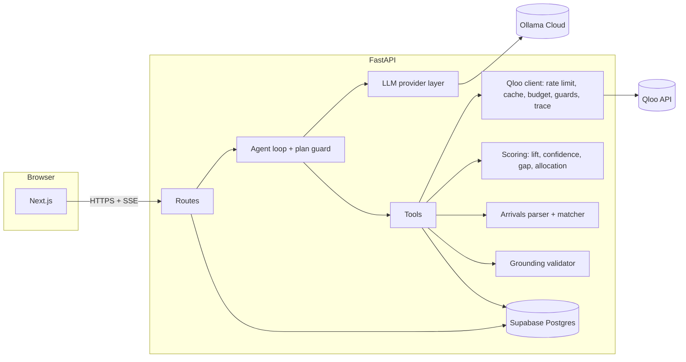
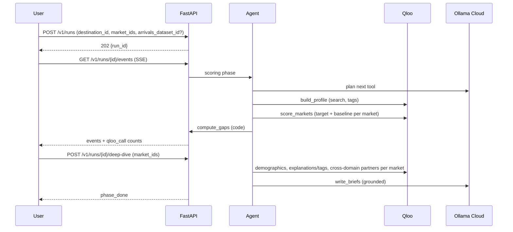

# 03. Architecture

## Monorepo layout (extends your existing Turborepo)

```
.
├─ apps
│  ├─ web                                   # Next.js App Router (existing)
│  │  ├─ app/
│  │  │  ├─ page.tsx                        # landing
│  │  │  ├─ start/page.tsx                  # intake wizard: destination, profile, markets, arrivals
│  │  │  ├─ runs/[id]/page.tsx              # live progress, market table, gap quadrant
│  │  │  ├─ runs/[id]/markets/[marketId]/page.tsx   # market detail: lift, audience, angle, partners, evidence
│  │  │  ├─ runs/[id]/plan/page.tsx         # shortlist, budget sliders, briefs, export
│  │  │  ├─ runs/[id]/trace/page.tsx        # full call trace
│  │  │  └─ sample/page.tsx                 # stored demo run (no keys)
│  │  ├─ lib/api.ts                         # typed client (types from packages/contracts)
│  │  └─ lib/sse.ts                         # run events
│  └─ api                                   # FastAPI (Python 3.12, uv)
│     ├─ pyproject.toml
│     ├─ package.json                       # wrapper scripts for turbo
│     ├─ .env.example
│     ├─ src/tastebound_api/
│     │  ├─ main.py  settings.py  errors.py  schemas.py
│     │  ├─ db/                             # asyncpg pool + repositories
│     │  ├─ qloo/                           # client, rate limit, cache, budget, trace, guards, models
│     │  ├─ scoring/                        # percentiles, lift, confidence, gap, allocation (pure)
│     │  ├─ arrivals/                       # CSV parsing, market matching
│     │  ├─ external/website_reader.py      # SSRF-safe page reader
│     │  ├─ agent/                          # loop.py, tools.py, plan_guard.py, deterministic_plan.py
│     │  ├─ llm/                            # base.py, ollama_cloud.py, gemini.py, openai_compat.py, fake.py, structured.py, prompts/
│     │  ├─ grounding.py                    # validates LLM briefs against evidence
│     │  ├─ data/markets.json               # origin market catalogue
│     │  ├─ data/samples/                   # bundled public arrivals sample(s) with source notes
│     │  └─ routes/                         # health, workspaces, destinations, markets, runs, plans, trace, demo
│     ├─ scripts/                           # spike_qloo.py, spike_llm_tools.py, record_fixture.py, load_markets.py, seed_demo.py, evaluate.py, backtest.py, export_openapi.py, cleanup.py
│     └─ tests/                             # unit, contract, integration, api, live
├─ packages
│  ├─ contracts                             # TS types generated from apps/api/openapi.json
│  ├─ ui  eslint-config  typescript-config  # existing
├─ supabase/                                # config.toml, migrations/, seed.sql
├─ docs/                                    # this pack
└─ AGENTS.md  CLAUDE.md  turbo.json  pnpm-workspace.yaml  package.json
```

`apps/api/package.json` holds only scripts that call `uv run ...`, so `turbo dev/lint/test/build` covers both apps. Confirm `pnpm-workspace.yaml` includes `apps/*` and `packages/*`.

## Components



The browser talks only to FastAPI. Keys never leave the API.

## Run phases

1. **Scoring phase** (automatic after intake): `build_profile` → `score_markets` → `compute_gaps` → `finish_phase`.
2. **Deep-dive phase** (user shortlists 3–6 markets): `market_audience` → `market_angles` → `media_partners` → `write_briefs` → `finish_phase`.
3. **Allocation** runs in code instantly when the user moves sliders (no agent).



## Design rules

1. **Qloo decides, LLM narrates.** Scores, gaps, audiences, angle evidence and partners come from Qloo through pure functions in `scoring/`. The LLM chooses tools, proposes signature item **names**, and writes briefs that pass the grounding validator.
2. **Deterministic tools.** Same inputs and cache give identical scores whichever LLM or orchestration path ran.
3. **Agent with safety net.** Native tool calling on Ollama Cloud; plan guard; planner variant; deterministic fallback (`05-agent-and-llm.md`).
4. **Fail closed on Qloo.** No fallback scoring from any other source outside `APP_ENV=test`.
5. **Evidence everywhere.** Every number and claim links to a `qloo_calls` row or an arrivals row.
6. **Budget aware.** Per-run and monthly Qloo caps, shared cache, demo mode.

## Identity (no login)

`POST /v1/workspaces/session` returns an HMAC-signed workspace token (`SESSION_SECRET`). The web app stores it in `localStorage` (`tb_ws`) and sends `X-Workspace-Token` on every request; the SSE endpoint accepts it as the `token` query parameter. A header is used instead of a cookie because web and API are on different hosts in the hackathon deployment. Every user-owned row carries `workspace_id`; every query filters by it.

## Database

Supabase Postgres via asyncpg (`DATABASE_URL`). With the Supavisor transaction pooler, create the pool with `statement_cache_size=0` and never call `prepare()`; a long-running server can use the direct or session connection instead. SQL migrations in `supabase/migrations/`. RLS enabled on every table with no policies; only the server accesses data.

## Configuration (`apps/api/.env.example`)

```
APP_ENV=development                  # development | test | production
SESSION_SECRET=change-me
CORS_ORIGINS=http://localhost:3000
LOG_LEVEL=info

DATABASE_URL=postgresql://postgres.<ref>:<password>@<host>:5432/postgres
SUPABASE_URL=                        # optional, future Auth/Storage
SUPABASE_SERVICE_ROLE_KEY=           # optional, server only
TEST_DATABASE_URL=                   # tests only, never production

QLOO_API_KEY=
QLOO_BASE_URL=https://hackathon.api.qloo.com
QLOO_RPS=4
QLOO_MAX_CALLS_PER_RUN=200
QLOO_MONTHLY_CALL_LIMIT=10000
QLOO_CACHE_TTL_HOURS=168
QLOO_TIMEOUT_SECONDS=20
SCORING_STRATEGY=P                   # D | P | H, chosen in Phase 0 and stored in each run's settings

LLM_PROVIDER=ollama_cloud            # ollama_cloud | gemini | openai_compat | fake
OLLAMA_BASE_URL=https://ollama.com
OLLAMA_API_KEY=
OLLAMA_MODEL=gemma4:31b              # confirm the exact name at https://ollama.com/api/tags in Phase 0
GEMINI_API_KEY=
GEMINI_MODEL=
OPENAI_COMPAT_BASE_URL=
OPENAI_COMPAT_API_KEY=
OPENAI_COMPAT_MODEL=
LLM_TIMEOUT_SECONDS=90
LLM_TEMPERATURE_TOOLS=0.2
LLM_TEMPERATURE_WRITING=0.7
LLM_MAX_STEPS_PER_PHASE=12
LLM_MAX_CALLS_PER_RUN=40

WEBSITE_FETCH_TIMEOUT_SECONDS=12

DEMO_MODE_ENABLED=true
DEMO_RUN_ID=
PUBLIC_RUNS_PER_IP_PER_DAY=3
MAX_SIGNATURE_ITEMS=15
MAX_MARKETS_PER_RUN=40
MAX_SHORTLIST=6
```

`apps/web/.env.local`: `NEXT_PUBLIC_API_URL=http://localhost:8000`.

## Stack

| Layer | Choice |
|---|---|
| Frontend | Next.js (existing), React, TypeScript; charts per `DESIGN.md` (quadrant chart is required) |
| Backend | FastAPI, Uvicorn, httpx, Pydantic v2, pydantic-settings, asyncpg, trafilatura |
| Database | Supabase Postgres; migrations with Supabase CLI |
| Agent LLM | Ollama Cloud, Gemma 4 31B (default), provider layer for Gemini / OpenAI-compatible APIs |
| Taste data | Qloo Taste AI hackathon API |
| Tests | pytest, respx, Vitest, Testing Library, Playwright |
| Types | openapi-typescript → `packages/contracts` |
| Deploy | Vercel (web), Render/Railway/Fly (API, one instance), Supabase Cloud |
