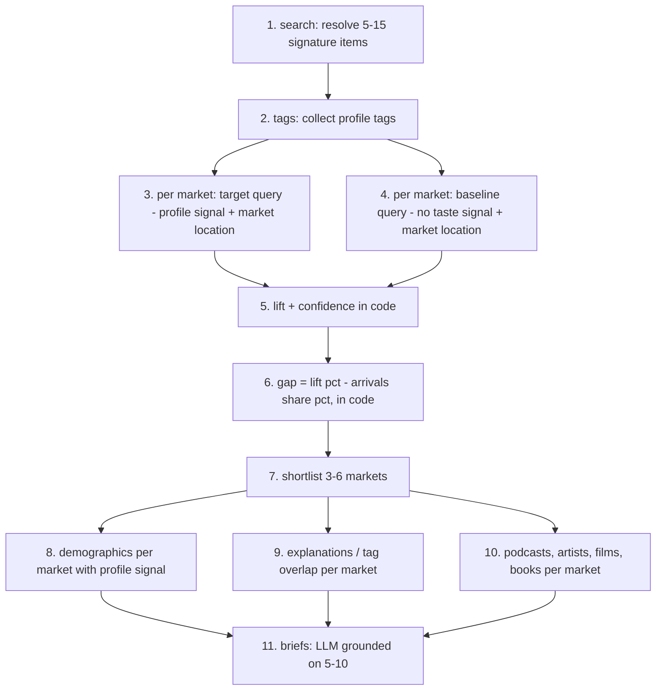

# 04. Qloo integration: how Qloo is used and why the app needs it

## Status of facts

| Fact                                                                                                                                                                                                                                              | Status                                                      |
| ------------------------------------------------------------------------------------------------------------------------------------------------------------------------------------------------------------------------------------------------- | ----------------------------------------------------------- |
| Base URL `https://hackathon.api.qloo.com`, header `X-Api-Key`, 5 req/s, 10,000 calls/month                                                                                                                                                        | From hackathon materials and earlier research; verify       |
| Endpoints `/search`, `/v2/insights`, `/v2/tags`, `/v2/audiences`, `/v2/analysis/compare`, `/v2/trending`                                                                                                                                          | Earlier research; verify each                               |
| Parameters `filter.type`, `filter.location`, `filter.location.query`, `filter.location.radius`, `filter.tags`, `signal.interests.entities`, `signal.interests.tags`, `signal.location`, `signal.location.radius`, `signal.demographics.*`, `take` | Earlier research; verify each                               |
| Entity types including `urn:entity:place`, `urn:entity:locality`, `urn:entity:destination`, `urn:entity:artist`, `urn:entity:podcast`, `urn:entity:movie`, `urn:entity:book`, `urn:entity:brand`; demographics and heatmap insight types          | Earlier research; `destination` especially must be verified |
| Quirks: brands ignore location; heatmaps track popularity closely (0.92–0.97 in earlier tests) so they need a baseline; invalid params can return 200 silently; tag search matches any word                                                       | Observed earlier; re-check                                  |
| Coverage outside the US                                                                                                                                                                                                                           | **Unknown; Phase 0 must measure it**                        |
| Response field names (affinity, popularity, explainability output)                                                                                                                                                                                | **Unknown until Phase 0**                                   |

Phase 0 records raw responses as fixtures and writes `docs/qloo-contract.md`. Pydantic models are built from fixtures. When this file disagrees with live behaviour, update this file.

## Capability → feature → decision

| Qloo capability                                                       | Feature       | Decision it drives                                            |
| --------------------------------------------------------------------- | ------------- | ------------------------------------------------------------- |
| Entity search                                                         | F02           | Which entities represent the destination                      |
| Tags (`/v2/tags`, tags on entities)                                   | F02, F06      | The destination's taste vocabulary; angle evidence            |
| Location-aware insights / destination affinity / heatmap              | F03           | How strongly each origin market likes the destination's taste |
| Same queries without the taste signal (baseline)                      | F03           | Removes plain popularity and city size (lift)                 |
| Demographics (`urn:demographics` or audiences) with location          | F05           | Who in each market to target                                  |
| Explainability and shared tags                                        | F06           | Why a market fits: the campaign angle evidence                |
| Cross-domain insights (podcasts, artists, films, books) with location | F07           | Media partners per market                                     |
| Compare (`/v2/analysis/compare`)                                      | F08 (stretch) | Positioning against a rival destination                       |
| Trending                                                              | X3 (stretch)  | Timing, only if verified                                      |

## The multi-call chain

Every step after 1 depends on earlier Qloo outputs; steps 5–6 are deterministic code; step 11 is the only LLM content step and is validated.

## Scoring strategies (Phase 0 chooses one; keep the others as fallbacks)

**Strategy D: destination affinity per market.** For each origin market, query insights with `filter.type=urn:entity:destination` (or `urn:entity:locality`) and `signal.location` set to the market (point + radius), and read the rank/affinity of our destination among results. Baseline: the same destination's global rank without location. Simple and direct, **if** destinations are entities and our destination appears in results.

**Strategy P: profile affinity per market.** For each market, query insights for the entity types in the profile (places, artists, films, books), with `signal.location` = market and `signal.interests.entities` = profile entities, restricted to the profile's own entities if the API supports filtering to specific ids (verify), and aggregate their affinity. Baseline: the same query without `signal.interests`. Lift = target affinity − baseline affinity, aggregated across entities.

**Strategy H: heatmap.** One heatmap query with the profile as signal; aggregate heat inside each market's radius; divide by a baseline heatmap (no signal or generic signal) to remove population. Cheapest in calls, but heatmaps track popularity strongly, so the baseline division is mandatory.

**Choosing:** in Phase 0, run all three for two very different destinations (for example Lisbon and Kyoto) over 20 markets. Pick the strategy whose rankings (a) differ most between the two destinations, (b) are least correlated with market population, (c) have results for at least 80% of markets. Record the choice and numbers in the decisions log.

## Normalisation and scores (in `scoring/`)

- Convert each query's ranking field to a **percentile within that query** (0–1). If only order is returned: `pct = 1 − (rank − 1)/n`.
- **Lift** per market = `target_affinity − baseline_affinity` (Strategy D/P) or `log(target_heat / baseline_heat)` (Strategy H). Percentiles of target and baseline are kept for display, but subtracting percentiles collapses the signal because both are rank-identical within a response.
- **Taste score** = percentile of lift across the run's markets (0–100).
- **Confidence:** High if the market has results for ≥ 70% of profile entities and lift is stable when any single profile entity is dropped (leave-one-out change in rank ≤ 3); Medium if ≥ 40% coverage; Low otherwise. Leave-one-out uses stored responses only where the strategy allows; otherwise use coverage only and say so.
- **Gap** (only with arrivals) = taste percentile − arrivals-share percentile, across matched markets. Quadrants by thresholds 0.5/0.5 (configurable).
- `scoring_version` and all thresholds are stored with each run.

## Client (`qloo/client.py`)

Async httpx; token bucket at `QLOO_RPS` (4); retries on 429/5xx/timeouts (0.5, 1, 2 s with jitter, max 3); no retry on 400/401/403; cache keyed by SHA-256 of method, path, sorted params (no key) for `QLOO_CACHE_TTL_HOURS`; per-run cap `QLOO_MAX_CALLS_PER_RUN`; monthly guard at 80% of `QLOO_MONTHLY_CALL_LIMIT`; a `qloo_calls` trace row for every call (live or cached); typed errors `QlooAuthError`, `QlooRateLimited`, `QlooUnavailable`, `QlooBadRequest`, `QlooBudgetExceeded`, `QlooContractViolation`.

## Guards against silent failures

After each response: shape matches the fixture-built model; entity types match `filter.type`; location-filtered results lie within radius (10% tolerance) when coordinates are returned; tag filters are honoured when tags are returned; more than 30% violations → warning; 100% → `QlooContractViolation`.

## Call budget per run (estimate; Phase 0 updates it)

| Step                                                                   | Calls                                 |
| ---------------------------------------------------------------------- | ------------------------------------- |
| Resolve 12 signature items                                             | 12                                    |
| Tags                                                                   | 2–4                                   |
| Score 30 markets (target + baseline)                                   | 60 (Strategy D/P) or 2–4 (Strategy H) |
| Deep dive 5 markets × (demographics 1 + explanations 1–2 + partners 4) | 30–35                                 |
| **Total**                                                              | about 50–115                          |

Cap `QLOO_MAX_CALLS_PER_RUN=200`. With caching and the demo run, 10,000 monthly calls are ample if tests never call live.

The post-run results assistant makes **zero Qloo calls**. It reads stored run outputs and can only cite evidence already produced by the run; it cannot fetch new data or trigger a scoring phase.

## Kill switch (must pass, shown in the video)

With `QLOO_API_KEY` empty or invalid, a new run fails at `build_profile` with `qloo_unconfigured` or `qloo_auth`. No profile, scores, gaps, audiences, angles, partners or briefs are produced; no brief-writing LLM call is made. The stored sample run still loads and is labelled as stored data.

## What Qloo does not give (never claim it)

Visitor forecasts, booking intent, flight access, prices, or individual traveller data. TasteBound says "taste fit", not "demand". The gap view combines taste fit with real arrivals; it does not predict arrivals.
