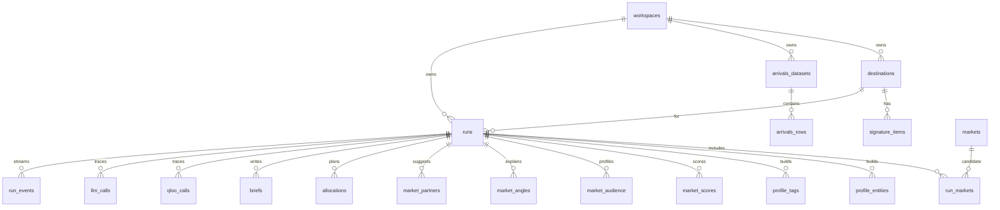

# 06. Data model (Supabase Postgres)

## Principles

- Schema only through SQL migrations in `supabase/migrations/` (`supabase migration new`, `supabase db reset` locally, `supabase db push` to cloud).
- **RLS enabled on every table, no policies.** Only FastAPI (via `DATABASE_URL`) reads or writes.
- Every user-owned row has `workspace_id`; repositories always filter by it.
- Raw provider responses stored for cache and trace, with expiry.

## Relationships



## Migration `0001_init.sql`

```sql
create extension if not exists citext;

create table workspaces (
  id uuid primary key default gen_random_uuid(),
  kind text not null default 'anon' check (kind in ('anon','demo')),
  created_at timestamptz not null default now(),
  last_seen_at timestamptz not null default now()
);

create table markets (                         -- catalogue, loaded from data/markets.json
  id text primary key,                         -- e.g. 'gb-london'
  city text not null,
  country_code char(2) not null,
  region text not null,
  lat double precision not null,
  lon double precision not null,
  radius_km integer not null default 40,
  population_band smallint not null check (population_band between 1 and 5),
  active boolean not null default true
);

create table destinations (
  id uuid primary key default gen_random_uuid(),
  workspace_id uuid not null references workspaces(id) on delete cascade,
  name text not null,
  country_code char(2) not null,
  website_url text,
  lat double precision, lon double precision, radius_km integer,
  source_text text,
  source_text_expires_at timestamptz,
  confirmed_at timestamptz,
  created_at timestamptz not null default now()
);

create table signature_items (
  id uuid primary key default gen_random_uuid(),
  workspace_id uuid not null references workspaces(id) on delete cascade,
  destination_id uuid not null references destinations(id) on delete cascade,
  name text not null,
  kind text not null check (kind in ('landmark','neighbourhood','dish','drink','venue','festival','music','film','book','brand')),
  origin text not null check (origin in ('llm_website','llm_name_only','user')),
  position smallint not null default 0
);

create table arrivals_datasets (
  id uuid primary key default gen_random_uuid(),
  workspace_id uuid not null references workspaces(id) on delete cascade,
  destination_id uuid references destinations(id) on delete set null,
  name text not null,
  year integer,
  level text not null check (level in ('city','country','mixed')),
  source_note text not null,                   -- where the numbers come from
  is_sample boolean not null default false,
  created_at timestamptz not null default now()
);

create table arrivals_rows (
  id bigserial primary key,
  dataset_id uuid not null references arrivals_datasets(id) on delete cascade,
  origin_raw text not null,
  arrivals bigint not null check (arrivals >= 0),
  year integer,
  matched_market_id text references markets(id),
  matched_country char(2)
);

create table runs (
  id uuid primary key default gen_random_uuid(),
  workspace_id uuid not null references workspaces(id) on delete cascade,
  destination_id uuid not null references destinations(id) on delete cascade,
  arrivals_dataset_id uuid references arrivals_datasets(id) on delete set null,
  status text not null default 'queued'
    check (status in ('queued','scoring','scored','deep_dive','done','failed')),
  orchestration text check (orchestration in ('agent','planner','deterministic_fallback')),
  orchestration_reason text,
  scoring_version text not null,
  settings jsonb not null default '{}',        -- strategy, thresholds, weights, limits
  counters jsonb not null default '{}',        -- qloo_live, qloo_cached, llm
  shortlist text[] not null default '{}',
  client_ip_hash text,
  error_code text, error_message text,
  created_at timestamptz not null default now(),
  started_at timestamptz, finished_at timestamptz
);
create index runs_ws_idx on runs(workspace_id, created_at desc);
create index runs_ip_idx on runs(client_ip_hash, created_at);

create table run_markets (
  run_id uuid not null references runs(id) on delete cascade,
  market_id text not null references markets(id),
  primary key (run_id, market_id)
);

create table qloo_calls (
  id uuid primary key default gen_random_uuid(),
  run_id uuid references runs(id) on delete set null,
  step text not null,
  endpoint text not null,
  params jsonb not null,                       -- never contains the key
  cache_key text not null,
  cache_hit boolean not null default false,
  status integer, duration_ms integer, result_count integer,
  warnings jsonb not null default '[]',
  response jsonb,
  expires_at timestamptz,
  created_at timestamptz not null default now()
);
create index qloo_cache_idx on qloo_calls(cache_key, expires_at desc) where cache_hit = false and status = 200;
create index qloo_run_idx on qloo_calls(run_id, created_at);
create index qloo_month_idx on qloo_calls(created_at) where cache_hit = false;

create table llm_calls (
  id uuid primary key default gen_random_uuid(),
  run_id uuid references runs(id) on delete set null,
  purpose text not null, provider text not null, model text not null,
  prompt_version text not null, status text not null,
  duration_ms integer, input_tokens integer, output_tokens integer,
  created_at timestamptz not null default now()
);

create table profile_entities (
  id uuid primary key default gen_random_uuid(),
  run_id uuid not null references runs(id) on delete cascade,
  item_id uuid references signature_items(id) on delete set null,
  qloo_entity_id text not null,
  name text not null, entity_type text not null,
  role text not null check (role in ('destination','item')),
  similarity numeric(4,3),
  source_call_id uuid references qloo_calls(id),
  unique (run_id, qloo_entity_id)
);

create table profile_tags (
  run_id uuid not null references runs(id) on delete cascade,
  tag_id text not null, label text not null, entity_count integer not null,
  primary key (run_id, tag_id)
);

create table market_scores (
  run_id uuid not null references runs(id) on delete cascade,
  market_id text not null references markets(id),
  target_pct numeric(5,4), baseline_pct numeric(5,4), lift numeric(6,4),
  taste_score numeric(5,2), coverage numeric(4,3),
  confidence text check (confidence in ('high','medium','low')),
  arrivals_share numeric(6,5), arrivals_pct numeric(5,4), gap numeric(5,4),
  quadrant text check (quadrant in ('untapped','core','habit','low_priority')),
  flags text[] not null default '{}',
  rank integer,
  source_call_ids uuid[] not null default '{}',
  primary key (run_id, market_id)
);

create table market_audience (
  run_id uuid not null references runs(id) on delete cascade,
  market_id text not null references markets(id),
  dimension text not null check (dimension in ('age','gender')),
  band text not null,
  share numeric(5,4), baseline_share numeric(5,4), over_index numeric(5,4),
  source_call_id uuid references qloo_calls(id),
  primary key (run_id, market_id, dimension, band)
);

create table market_angles (
  run_id uuid not null references runs(id) on delete cascade,
  market_id text not null references markets(id),
  headline text not null,
  evidence jsonb not null,                     -- [{id, kind, label, value, source_call_id}]
  primary key (run_id, market_id)
);

create table market_partners (
  id uuid primary key default gen_random_uuid(),
  run_id uuid not null references runs(id) on delete cascade,
  market_id text,                              -- null for global brands
  partner_type text not null check (partner_type in ('podcast','artist','movie','book','brand')),
  qloo_entity_id text not null, name text not null,
  lift numeric(6,4), rank integer not null,
  explanation text,
  source_call_id uuid references qloo_calls(id),
  unique nulls not distinct (run_id, market_id, partner_type, qloo_entity_id)
);

create table allocations (
  id uuid primary key default gen_random_uuid(),
  run_id uuid not null references runs(id) on delete cascade,
  workspace_id uuid not null references workspaces(id) on delete cascade,
  total numeric(14,2) not null, currency char(3) not null default 'USD',
  mode text not null check (mode in ('grow_untapped','defend_core')),
  shares jsonb not null,                       -- [{market_id, amount, share, locked}]
  created_at timestamptz not null default now()
);

create table briefs (
  id uuid primary key default gen_random_uuid(),
  run_id uuid not null references runs(id) on delete cascade,
  workspace_id uuid not null references workspaces(id) on delete cascade,
  market_id text not null references markets(id),
  content jsonb not null,                      -- title, summary, sections with cited ids
  source text not null check (source in ('llm','template')),
  edited boolean not null default false,
  model text, prompt_version text,
  created_at timestamptz not null default now(), updated_at timestamptz not null default now(),
  unique (run_id, market_id)
);

create table run_events (
  id bigserial primary key,
  run_id uuid not null references runs(id) on delete cascade,
  seq integer not null, type text not null, payload jsonb not null default '{}',
  created_at timestamptz not null default now(),
  unique (run_id, seq)
);

create table evaluations (
  id uuid primary key default gen_random_uuid(),
  run_id uuid references runs(id) on delete set null,
  method text not null, results jsonb not null,
  created_at timestamptz not null default now()
);

do $$ declare t text; begin
  foreach t in array array['workspaces','markets','destinations','signature_items','arrivals_datasets',
    'arrivals_rows','runs','run_markets','qloo_calls','llm_calls','profile_entities','profile_tags',
    'market_scores','market_audience','market_angles','market_partners','allocations','briefs',
    'run_events','evaluations']
  loop execute format('alter table %I enable row level security', t); end loop;
end $$;
```

## Retention (`scripts/cleanup.py`, daily)

Website text 30 days; raw responses nulled 7 days after `expires_at` (trace rows stay); inactive anonymous workspaces deleted after 60 days (cascade); demo workspace kept; uploaded arrivals deleted with their workspace.

## Connection

asyncpg pool (5–10). Transaction pooler → `statement_cache_size=0`, no `prepare()`. Tests use `TEST_DATABASE_URL` or local `supabase start`.
